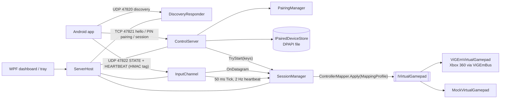

# Architecture (Windows side)

The Android side is documented separately; the wire format is `shared/protocol/PROTOCOL.md` (normative).

## Projects (`windows-app/`)

| Project | Responsibility | Depends on |
|---|---|---|
| `Phone2Gamepad.Core` | Pure logic, no I/O: `GamepadState`, `PacketCodec` (encode/decode/validate), `SequenceTracker` (serial-number arithmetic), `ProtocolCrypto` (ECDH P-256, HKDF-SHA256, HMAC-SHA256 via `System.Security.Cryptography`), `MappingProfile`/`ControllerMapper` | - |
| `Phone2Gamepad.VirtualGamepad` | `IVirtualGamepad` (Connect / Submit / Neutralize / Status / Disconnect), `ViGEmVirtualGamepad`, `MockVirtualGamepad`. The only project that references the driver library (`Nefarius.ViGEm.Client` 1.21.256, pinned). | Core |
| `Phone2Gamepad.Network` | `ControlServer` (TCP), `InputChannel` (UDP), `DiscoveryResponder`, `PairingManager`, `SessionManager`, `DpapiPairedDeviceStore`, `ServerStats`, `ServerHost` (composition root), and `PhoneClient` (reference phone-side implementation used by tests/tools) | Core, VirtualGamepad |
| `Phone2Gamepad.Windows` | WPF (MVVM) dashboard, tray icon, settings, logging UI | Network |
| `Phone2Gamepad.HeadlessHost` | Console host of the same `ServerHost` for diagnostics / e2e | Network |
| `tests/Phone2Gamepad.Tests` | xUnit tests | Core, Network |
| `tests/Phone2Gamepad.TestClient` | Phone simulator + XInput verifier | Network |

Networking and UI never see the driver: they talk to `IVirtualGamepad`. Replacing ViGEmBus (retired upstream, see `DRIVER_DECISION.md`) means adding one class.

## Data flow for one input packet

1. `InputChannel` receives a datagram and calls `SessionManager.OnDatagram`.
2. Validation, in this order, any failure = drop + counter (never act): exact length (46/40) -> magic/version -> type -> session id -> HMAC tag with the session's phone-to-PC key (constant-time) -> source IP equals the control connection's peer -> sequence strictly newer (duplicates and reordered packets are dropped and counted separately).
3. STATE: `ControllerMapper.Apply` (D-pad opposites cancel, remap, dead zone, sensitivity, inversion, trigger calibration, -32768 clamped to -32767) then `IVirtualGamepad.Submit` (skips unchanged states). HEARTBEAT: updates liveness and RTT.
4. Every 50 ms `Tick()`: 500 ms without a valid packet -> `Neutralize()`; 5 s -> session ended. TCP close, revoke, server stop and replacement by a new session also neutralize immediately.

## Threading

* Receive loops are async tasks; the 50 ms timer task runs `Tick` and sends heartbeats. `SessionManager` state is guarded by one lock; the gamepad is called outside it; events are raised outside it.
* The virtual controller is updated from the receive thread (no UI thread involvement). UI code reads state through properties and marshals with the dispatcher.

## Sessions and security (summary; details in the protocol doc)

* Pairing: ECDH P-256 + 6-digit PIN bound into the confirmation key (HKDF) + explicit approval on the PC. 120 s window, single use, 5 wrong proofs close it, 1 failed attempt/s/IP.
* Per-session keys derived from the per-device secret and fresh nonces (reconnect = new keys, an old session can never control the pad).
* Only loopback / RFC1918 / link-local peers are accepted (`ServerOptions.PrivateNetworksOnly`, default on).
* Device secrets are stored with DPAPI (CurrentUser). PINs and secrets are never logged.

## Known limitations

* One phone, one controller (the session manager returns `busy` to a second device).
* IPv4 only. USB transport, QR pairing, vibration feedback are not implemented.
* The ViGEmBus driver is a required, separately installed dependency (this app never installs drivers).
